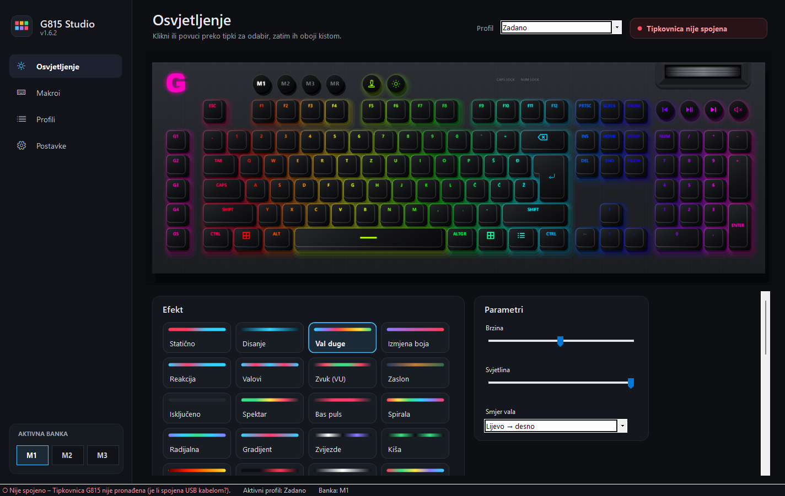
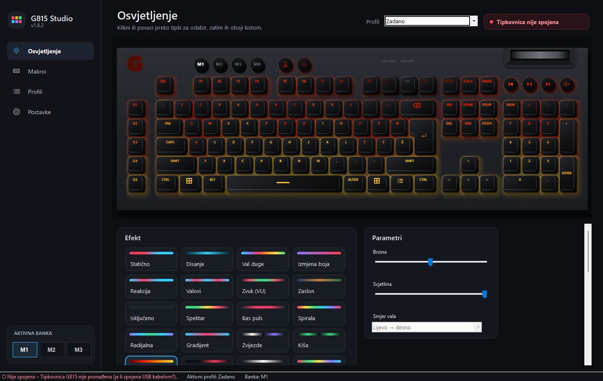
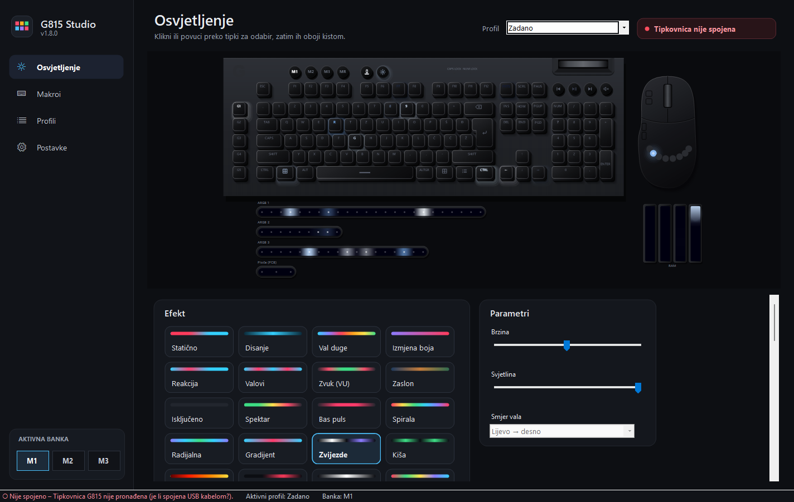
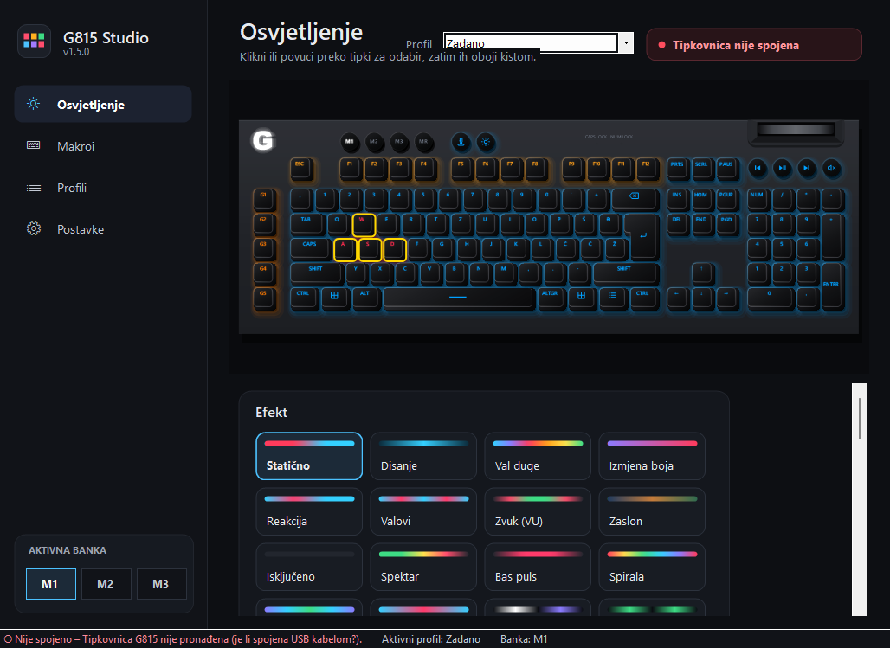
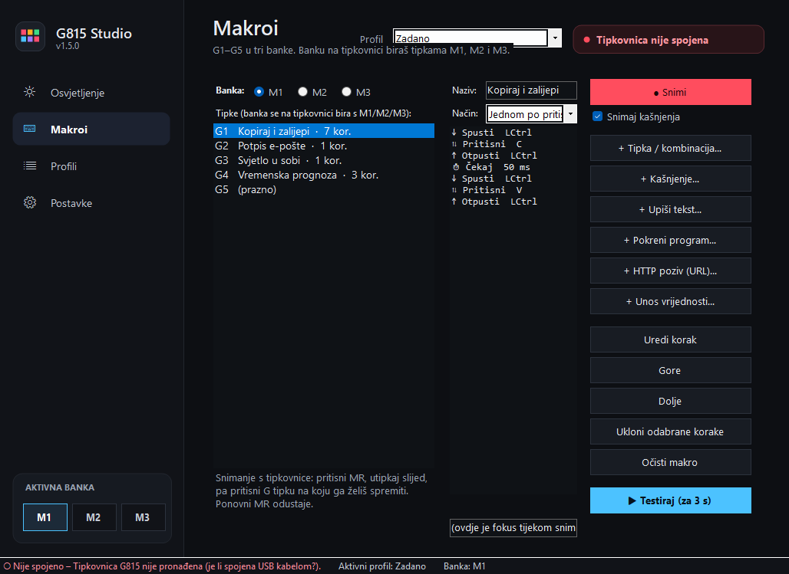
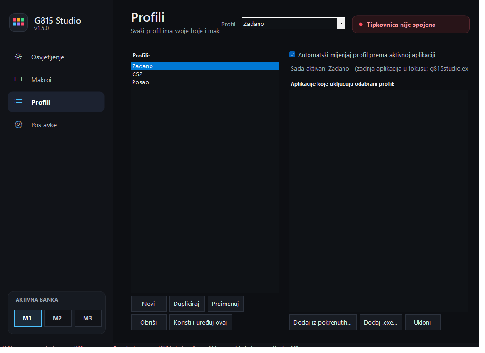
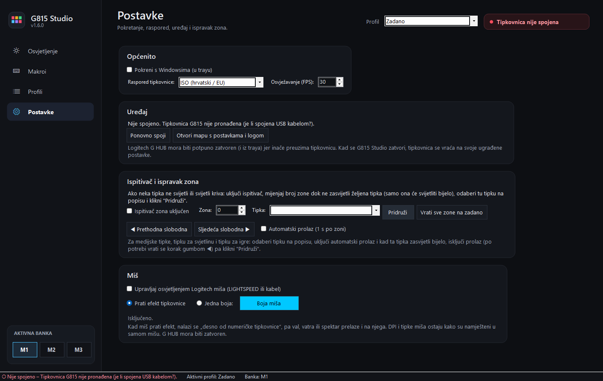

# G815 Studio

Lagana zamjena za Logitech G HUB za tipkovnicu **Logitech G815 LIGHTSYNC** (Windows 10/11).

G815 Studio upravlja osvjetljenjem svake tipke, efektima, makroima na G tipkama i profilima. Živi kao mala ikona u trayu, bez servisa u pozadini i bez telemetrije. Nema vanjskih ovisnosti: tipkovnicom upravlja izravno preko USB-a (Logitechov HID++ 2.0 protokol), na isti način kao OpenRGB.

Popis promjena po verzijama je u [CHANGELOG.md](CHANGELOG.md).

## Preuzimanje

Najnoviju verziju preuzmi u [Releases](../../releases). `G815Studio.exe` je jedna samostalna datoteka, ne treba ništa instalirati, a ni .NET.

Prije prvog pokretanja potpuno zatvori Logitech G HUB, i iz traya.

## Mogućnosti

### Osvjetljenje
- **Boja svake tipke posebno:** klikni ili povuci preko tipki pa ih oboji kistom. Brzi odabir: slova, WASD, F tipke, numerička, G tipke, mediji…
- **Sve RGB tipke:** uz glavne tipke i G1–G5 tu su i logo, tipka za igre, tipka za svjetlinu i medijske tipke.
- **20 efekata:** statično, disanje, val duge, izmjena boja, reakcija na pritisak, valovi od pritiska, VU metar, spektar zvuka, bas puls, spiralna i radijalna duga, gradijentni val, zvjezdano nebo, kiša/Matrix, vatra, skener, munja, mozaik, boje sa zaslona, isključeno.
- **Svaki efekt ima svoje boje, brzinu i smjer.** Efekti s dugom mogu koristiti i vlastite boje.
- **Zvuk u stvarnom vremenu:** efekti prate glazbu sa zvučnika uz kašnjenje od oko 20 ms (WASAPI loopback + FFT).

| Vatra | Zvjezdano nebo | Statično (WASD istaknut) |
|---|---|---|
|  |  |  |

### Makroi
- **G1–G5 u tri banke (M1/M2/M3):** 15 makroa po profilu.
- **Koraci:** tipka ili kombinacija, spusti/otpusti, kašnjenje, upiši tekst (i č/ć/š/đ/ž), pokreni program, **HTTP poziv** (npr. Home Assistant webhook) i **unos vrijednosti**.
- **Varijable:** `{naziv}`, `{naziv:url}`, `{datum}`, `{vrijeme}`, `{clipboard}`, `{status}`, `{odgovor}`.
- **Načini:** jednom, ponavljaj dok je tipka držana, uključi/isključi.
- **Snimanje** iz programa ili izravno s tipkovnice: **MR → utipkaj → G tipka**.

### Profili i ostalo
- **Profili** s automatskim prebacivanjem prema aplikaciji u fokusu (npr. `cs2.exe`).
- **Tray ikona:** otvaranje prozora, brza promjena profila, gašenje osvjetljenja, izlaz.
- Pokretanje s Windowsima (u trayu).
- ISO (hrvatski) i ANSI raspored.

| Profili | Postavke |
|---|---|
|  |  |

> Snimke zaslona automatski radi GitHub Actions na Windowsima bez spojene tipkovnice, pa piše „Tipkovnica nije spojena“. Profili i makroi na slikama su primjeri.

## Korištenje

- **Logitech G HUB mora biti potpuno zatvoren** (i iz traya). Najbolje ga je deinstalirati ili isključiti njegovo pokretanje s Windowsima, inače preuzima tipkovnicu.
- Tipkovnica mora biti spojena **USB kabelom**.
- Kad zatvoriš G815 Studio (Izlaz u trayu), tipkovnica se vraća na svoje ugrađene postavke.
- Postavke su u `%APPDATA%\G815Studio\settings.json`, a dnevnik u `log.txt` u istoj mapi.

## Ako neka tipka ne svijetli ispravno

Ako neka tipka ne reagira, idi u **Postavke → Ispitivač i ispravak zona**:

1. Na popisu odaberi tipku.
2. Uključi *Automatski prolaz* ili koristi gumbe *Prethodna / Sljedeća slobodna*.
3. Kad tipka zasvijetli bijelo, klikni **Pridruži**.

## Izrada (build)

1. Instaliraj [.NET 8 SDK](https://dotnet.microsoft.com/download/dotnet/8.0).
2. Pokreni `build.bat`.
3. Gotov program je `publish\G815Studio.exe`.

Workflow `build.yml` izradi exe na svaki push. Kad se objavi release, sam ga doda releaseu. Workflow `screenshots.yml` osvježava slike u ovom README-u.

## Tehničke bilješke

- Indeksi HID++ značajki otkrivaju se dinamički: 0x8081 per-key osvjetljenje, 0x8100 ugrađeni profili (host način), 0x8010 G tipke, 0x8020 M tipke, 0x8030 MR.
- Boje se šalju kao u OpenRGB-u: samo promijenjene tipke, grupirane po boji (do 13 tipki po paketu), bez čekanja potvrde, s commitom na kraju.
- Reaktivni efekti i snimanje koriste globalni hook tipkovnice. On je aktivan samo dok je potreban.
- Makroi šalju scan kodove (SendInput) pa rade i u većini igara. Neke igre s anti-cheatom blokiraju umjetni unos.
